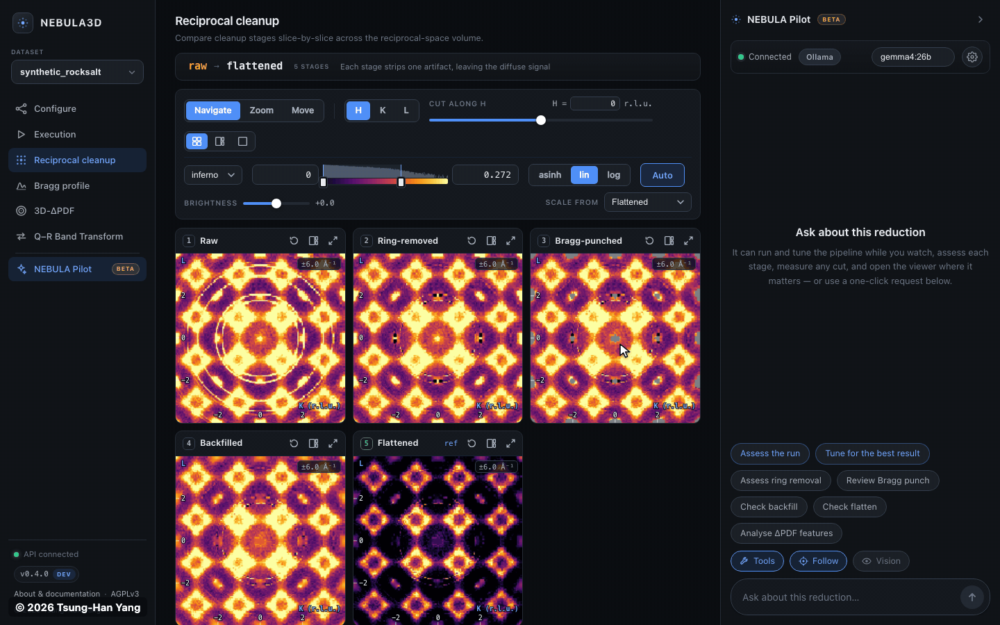

# NEBULA3D

**NEBULA3D** (*Neutron Elastic Background Utility for Local Analysis and
3D-ΔPDF*) is a Python package and browser console that cleans 3D
reciprocal-space diffuse-scattering volumes, neutron or X-ray, into real-space
3D-ΔPDF maps, with an AI agent that assesses and tunes the reduction with you.

**Try it in the browser:** https://drthyang.github.io/nebula3d/ runs the whole
pipeline client-side; nothing is uploaded.



*NEBULA Pilot on the built-in synthetic demo volume (simulated data, not
measured), with a local model. A time-lapse: the waits for the model are sped
up.*

## What it does

- **The reduction, stage by stage:** powder-ring removal, Bragg and satellite
  punch, backfill, radial-background flatten, the 3D-ΔPDF transform and a
  back-FFT consistency check ([the pipeline](docs/pipeline.md)).
- **Aware of the crystal:** the stages keep the symmetry the input declares,
  non-orthogonal cells are fine, and the UB can be checked and refined from
  where the Bragg peaks sit.
- **Powder rings told from diffuse:** a shell is subtracted only if it rises in
  nearly every direction in 3D, so the crystal's own diffuse stays
  ([powder rings](docs/algorithms/powder_rings.md)).
- **One console, two run modes:** the static web app runs the pipeline in your
  browser; `nebula3d-web` serves the same console natively, with no size limit.
- **Mantid files in and out:** it loads NeXus Viewer and Mantid exports, and
  writes volumes that Mantid's `LoadMD` opens.

## Quick start

Open **https://drthyang.github.io/nebula3d/**, load the built-in demo volume
(**Use demo**) or your own `.nxs`/`.h5`, and press **Run pipeline**.

To run it natively, from a clone (Python 3.10+ and Node.js):

```bash
pip install -e ".[web]"
make web-install && make ui     # build the console once
nebula3d-web                    # serves http://127.0.0.1:8000
```

More, including the batch scripts: [QUICKSTART.md](QUICKSTART.md).

## NEBULA Pilot

An agent docked beside every page. Connect a local model (Ollama, LM Studio) or
a cloud one (OpenAI, Gemini, Anthropic): it measures cuts, judges each stage,
runs and tunes the pipeline, and shows you the figures it reads. Every number
comes from deterministic metrics, and each answer is checked against the
tools' results before you read it. Its tools, guardrails and evals:
[docs/pilot.md](docs/pilot.md).

## Status

Beta: the latest release is 0.3.0, and `main` carries the 0.4.0 work
([CHANGELOG.md](CHANGELOG.md)). CI runs the Python tests on 3.10–3.13 with
ruff and mypy, and the console's tests and builds, including replays of the
agent's evals ([docs/development.md](docs/development.md#tests-and-ci)).

## Documentation

- [Quickstart](QUICKSTART.md): run the console, in the browser or natively.
- [The console](docs/web.md): its views, run modes and architecture.
- [NEBULA Pilot](docs/pilot.md): the agent's tools, guardrails and
  [evals](docs/evals.md).
- [Running the pipeline](docs/pipeline.md): input data, the scripts, each
  stage, the Python API; also [command recipes](docs/commands.md).
- Algorithms: [powder rings](docs/algorithms/powder_rings.md),
  [Bragg cleanup](docs/algorithms/bragg_cleanup.md),
  [3D-ΔPDF](docs/algorithms/delta_pdf.md),
  [UB refinement](docs/algorithms/ub_refinement.md).
- [Development](docs/development.md): install from source, checks, CI.
- [All documentation](docs/README.md) · [Changelog](CHANGELOG.md)

## License and provenance

Copyright (C) 2026 Tsung-han Yang.

This project is licensed under the GNU Affero General Public License v3.0 or later.

This is an independent personal software project. It is not affiliated with,
sponsored by, endorsed by, funded by, developed for, or owned by any employer,
institution, laboratory, university, government agency, funding organization,
facility, or other organization.

Commercial, closed-source, proprietary, or alternative licensing may be available
only by separate written permission from the copyright holder.

See `PROVENANCE.md` for the project provenance statement.
