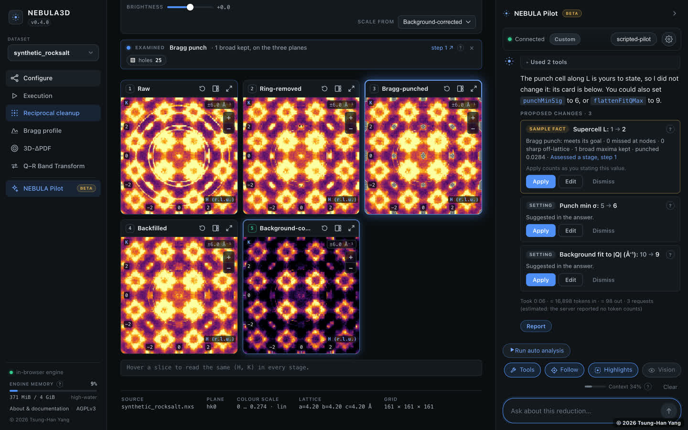
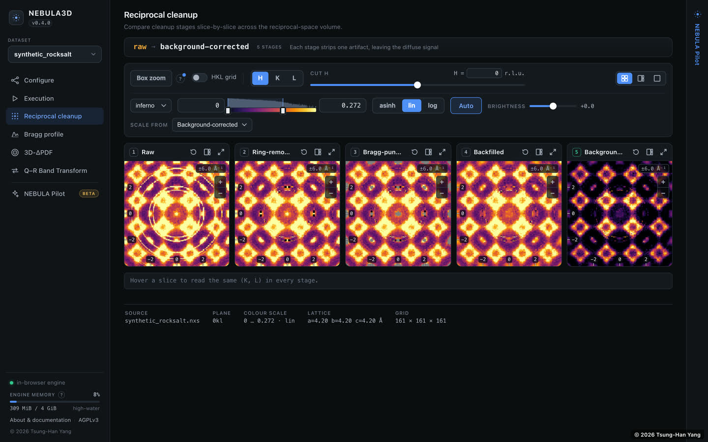
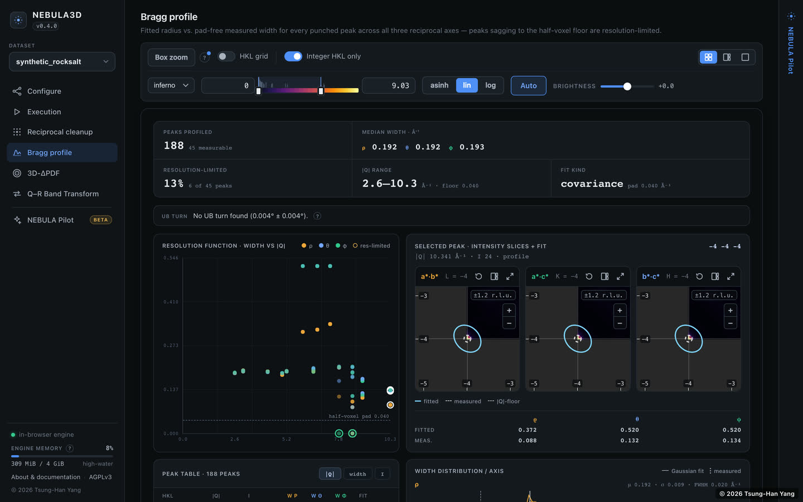
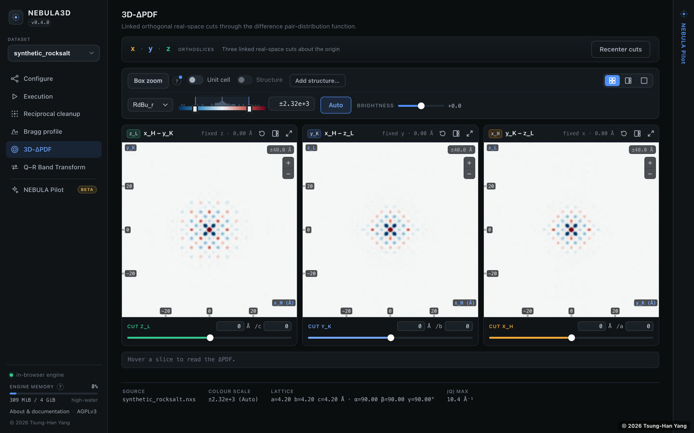
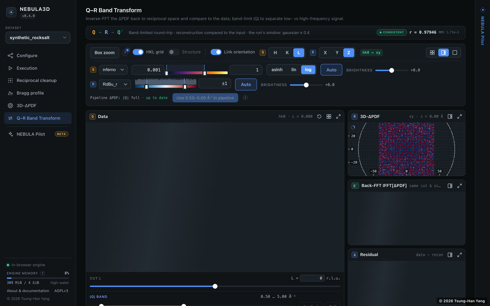
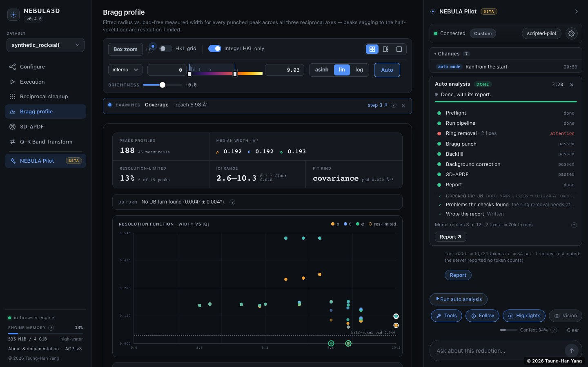
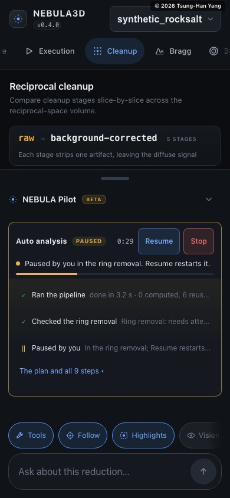
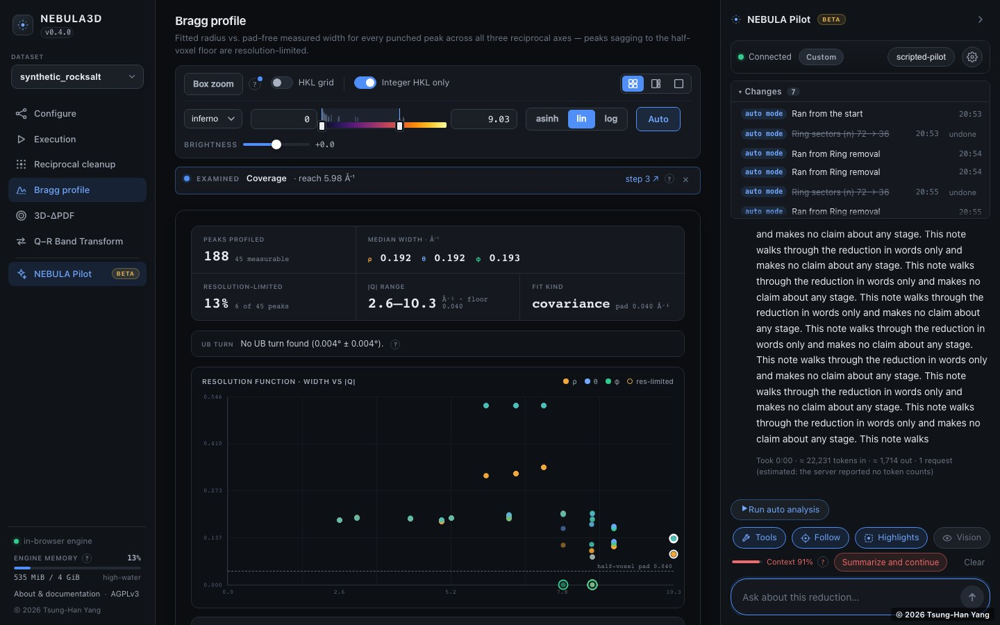
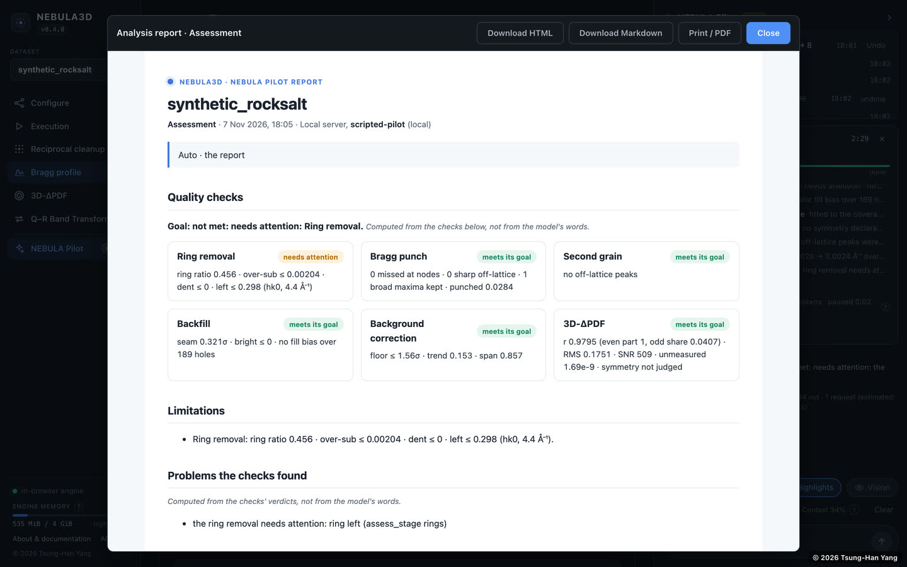

# NEBULA3D

**NEBULA3D** (*Neutron Elastic Background Utility for Local Analysis and
3D-ΔPDF*) reduces 3D single-crystal diffuse-scattering volumes, neutron or
X-ray, from the raw reciprocal-space volume to a real-space 3D-ΔPDF: powder
rings, Bragg peaks and background out, the crystal's own diffuse kept. It runs
in the browser (Pyodide, nothing uploaded) or natively, with **NEBULA Pilot**,
an AI agent that checks, runs and tunes the reduction with you.



*The synthetic demo volume (simulated, not measured) with a scripted model:
the Pilot proposes a sample fact and two settings as Apply cards, and its
Bragg punch check is drawn on the views.*

## Quick start

**In the browser:** open **https://drthyang.github.io/nebula3d/**, press
**Use demo** on the Configure page, then **Run pipeline** (about 15 s on an
Apple-silicon laptop). Your own `.nxs`/`.h5` loads the same way and stays on
your machine.

**Natively**, from a clone (Python 3.10+, Node.js):

```bash
git clone https://github.com/drthyang/nebula3d && cd nebula3d
pip install -e ".[web]"
make web-install && make ui        # build the console once
nebula3d-web                       # http://127.0.0.1:8000, reads ./data
```

To use the demo volume natively, write it to a data folder first:

```bash
mkdir -p demo/raw
python -c "import nebula3d; from nebula3d.demo import demo_volume; nebula3d.save(demo_volume(), 'demo/raw/synthetic_rocksalt.nxs')"
nebula3d-web --data-root demo
```

**The Pilot:** open *NEBULA Pilot* in the sidebar and connect a model. A local
one (Ollama, LM Studio) needs a 32k context; on the Pages site it also needs
CORS (`OLLAMA_ORIGINS`, or LM Studio's *Enable CORS*). Cloud models (OpenAI,
Gemini, Anthropic) take an API key and show a warning that run data leaves
your device. More in [QUICKSTART.md](QUICKSTART.md).

## What it does

- **The reduction, stage by stage:** an optional symmetry average, powder-ring
  removal, Bragg and satellite punch, backfill, background correction (the
  `flatten` stage), the 3D-ΔPDF and a back-FFT consistency check
  ([the pipeline](docs/pipeline.md)). A run from a stage first remakes any
  earlier output that is missing or stale.
- **Aware of the crystal:** stages keep the declared symmetry, non-orthogonal
  cells are supported, and the UB can be checked and refined from the Bragg
  peak positions.
- **Powder rings told from diffuse:** a shell is subtracted only if it rises in
  nearly every direction in 3D ([powder rings](docs/algorithms/powder_rings.md)).
- **One console, two engines:** the static site runs the Python pipeline in the
  browser; `nebula3d-web` serves the same console natively with no size limit.
- **Mantid files in and out:** it reads NeXus Viewer and Mantid exports and
  writes volumes that Mantid's `LoadMD` opens.

| | |
| --- | --- |
|  |  |
| **Reciprocal cleanup:** every stage on one plane and colour range. The *HKL grid* switch draws dashed lines at integer h, k, l. | **Bragg profile:** peak widths against \|Q\|, the UB turn the punch read, and the selected peak's slices. |
|  |  |
| **3D-ΔPDF:** three linked real-space sections. | **Q–R Band Transform:** a \|Q\| band applied here goes to the pipeline with *Use in pipeline*, then *Run from ΔPDF*. |

## NEBULA Pilot: how it works

The Pilot is a panel docked beside every page. With *Tools* on, a reply is an
agent loop of up to 12 rounds over **28 tools**: reading (cuts, the run log,
the Bragg profile), assessing (each stage's checks, rings, texture, coverage,
symmetry, UB, ΔPDF features, Laue classes), display, and acting (change
settings, run, tune, regrid). **Skills** are the user's written methods, one
per stage; a stage's settings change or are tuned only after its skill was read
in the same reply. Each check's result is drawn on the views as
**highlights**, from results already in memory. Details:
[docs/pilot.md](docs/pilot.md).

**Safety design.** The model explains; code measures and decides.

- **Verdicts come from tools.** Each stage's verdict is computed by a fixed
  rule in code, and so is the verdict on the whole run. The model writes a
  number as a reference, `{{tool.field}}`, and the app fills in the tool's
  value; a reference to nothing goes back to the model.
- **Answers are checked before you read them.** Code checks that each verdict
  has its tool in the reply, measured after the last run that changed that
  stage, that every number has a source, and that nothing contradicts a
  computed verdict. A failing answer is sent back once; what still fails is
  marked ⚠ under the reply.
- **Sample facts are yours.** A supercell, a modulation, the Laue class, the
  edge trim, the |Q| band and the magnetic ion change only when your message
  names them or you click Apply on their card. The click makes a one-use grant
  for exactly the card's values: an opaque token the model cannot see, copy or
  forge, which serializes to nothing.
- **The ring gate.** A ring-removal change waits for a 3D ring verdict on the
  current outputs. One bump on a 2D cut is not enough, since the crystal's own
  diffuse makes those too. Any run that recomputes the rings makes the earlier
  verdict stale.
- **Auto mode has hard limits.** *Run auto analysis* follows a fixed plan:
  preflight, run, check each stage, report. The app runs the checks and moves
  on by their verdicts; the model only fixes a flagged stage (two tries) and
  writes the report. A fix that makes its check worse is put back. A sample
  fact pauses the run for your click. It ends at 30 minutes of working time,
  12 model replies or $2 on Claude, each reply capped at 16,000 output tokens
  where the server sets no cap. Pause, Resume and Stop are always on screen;
  Stop ends the run with a report the app writes, at no model cost. One Undo
  puts back all of the run's changes.
- **No silent truncation.** A prompt is never cut to fit the model's window:
  a request that does not fit is refused with the fix. When older tool
  results are shortened, or earlier turns are no longer sent, the chat says
  so, and the answer checks always read the full results. A reply cut at its
  output cap is kept and marked.

Every change, by you, the Pilot or auto mode, appears in a **Changes** list
with Undo and in the report's Decisions section. A **context meter** by the
chat box shows how full the model's window is, and from 70 % offers
*Summarize and continue* (a summary the app writes, with no model call) or
*Start fresh*.

| | |
| --- | --- |
|  |  |
| **Auto mode, finished:** the plan, each stage's state and the activity log. | **On a phone:** the Now line and the last steps, with Resume and Stop. |
|  |  |
| **Context meter** at 93 %, offering *Summarize and continue*. | **The report:** each stage's check, and the problems the checks found, written by the app, not the model. |

All screenshots: the synthetic demo volume with a scripted model (a test
server with no model behind it), from the demo QA of 2026-11-07
([docs/demo-qa.md](docs/demo-qa.md)).

## Validation

Two layers check the Pilot ([docs/evals.md](docs/evals.md)):

- **Scenario evals** with known answers. CI replays every scenario with a
  scripted model; real models run them live.
- **A validation on synthetic cases** with a planted truth: eight fault
  families (a turned UB, a shifted HKL origin, cut coverage, powder rings, a
  diffuse shell to keep, a rising background, rings and shell together, and a
  control), each as a **dev** case for development and a held-out **test**
  case. The test split lives in its own module and loads only with an explicit
  opt-in; a test fails if any tunable file, these docs included, names a test
  case.
  - **Arms:** A, the default pipeline with no agent; B, the Pilot as shipped;
    B-auto, B through auto mode; C, the Pilot with its method (skills and
    inference) removed and its guardrails kept; D, the planted truth.
  - **Graders:** all in code and blind to the arm. The outputs are scored
    against the truth (planted ΔPDF features recovered, real diffuse kept,
    window on measured space, no pedestal); the conclusion is graded for the
    fault found, its size, and no false alarm; any unsafe action fails the
    run. The text graders changed on 2026-11-07 (three artefacts fixed,
    [Grader changes](docs/evals.md#grader-changes)); a result from before
    then is comparable only after a re-grade.
  - **Models:** a local arm (models on Ollama or LM Studio at a 32k context)
    and a Claude arm (paid, test split only, spend-capped), each request
    capped at 16,000 output tokens.

<!-- THY52-RESULTS -->
Re-baseline of 2026-11-07, on the **synthetic dev split only** (8 cases with a
planted truth; the test split stays sealed), graded by the validation graders
as of 2026-11-07. Arm B has the skills, arm C has none, and B-auto is auto mode.

| Model | Arm | Runs | Passed | Planted faults reported | Unsafe actions |
| --- | --- | ---: | ---: | ---: | ---: |
| gemma4:26b (local, 32k) | B | 8 × 1 | 5/8 | 3/6 | 0 |
| gemma4:26b (local, 32k) | B-auto | 8 × 1 | 4/8 | 3/6 | 0 |
| Claude Haiku 5.5 | B | 8 × 3 | 9/24 | 11/18 | 0 |
| Claude Haiku 5.5 | C | 8 × 3 | 6/24 | 10/18 | 0 |
| Claude Haiku 5.5 | B-auto | 8 × 1 | 3/8 | 3/6 | 0 |
| Claude Sonnet 5.5, on the cases Haiku failed | B | 13 | 9/13 | 7/7 | 0 |
| Claude Sonnet 5.5, on the cases Haiku failed | C | 18 | 11/18 | 13/16 | 0 |

A run passes only if every check holds: the outputs, the planted faults
reported, no false alarm and no unsafe action. On the same arm and cases as
the previous frozen baseline, gemma4:26b arm B went from 3/8 to 5/8 with fewer
tokens per run. Most Claude failures are charged false alarms, and many of
those read as grader artefacts that are documented but not yet fixed. Details,
per-case tables and spend are in
[docs/evals/validation/baseline-2026-11-07/](docs/evals/validation/baseline-2026-11-07/README.md).
<!-- /THY52-RESULTS -->

## Status

Beta. The latest release is **0.4.0** (2026-11-02). `main` carries the
unreleased work since then: the Pilot's Apply cards and Changes list, sample
facts on your click, auto mode, highlights, the context meter, the Q–R page's
*Use in pipeline*, the *HKL grid* name, and runs from a stage that remake
stale outputs ([CHANGELOG.md](CHANGELOG.md#unreleased)). CI runs the Python
tests on 3.10–3.13 with ruff and mypy, and the console's tests and both builds,
including replays of the agent's evals
([docs/development.md](docs/development.md#tests-and-ci)).

## Documentation

- [Quickstart](QUICKSTART.md): run the console, in the browser or natively.
- [The console](docs/web.md): its views, run modes and architecture.
- [NEBULA Pilot](docs/pilot.md): tools, guardrails, Apply cards, auto mode;
  [evals](docs/evals.md).
- [Running the pipeline](docs/pipeline.md): input data, scripts, each stage,
  the Python API; [command recipes](docs/commands.md).
- Algorithms: [powder rings](docs/algorithms/powder_rings.md),
  [Bragg cleanup](docs/algorithms/bragg_cleanup.md),
  [3D-ΔPDF](docs/algorithms/delta_pdf.md),
  [UB refinement](docs/algorithms/ub_refinement.md).
- [Demo script](docs/demo-script.md): a 5–10 minute live demo.
- [Development](docs/development.md): install from source, checks, CI.
- [All documentation](docs/README.md) · [Changelog](CHANGELOG.md)

## License and provenance

Copyright (C) 2026 Tsung-han Yang.

This project is licensed under the GNU Affero General Public License v3.0 or later.

This is an independent personal software project. It is not affiliated with,
sponsored by, endorsed by, funded by, developed for, or owned by any employer,
institution, laboratory, university, government agency, funding organization,
facility, or other organization.

Commercial, closed-source, proprietary, or alternative licensing may be available
only by separate written permission from the copyright holder.

See `PROVENANCE.md` for the project provenance statement.
