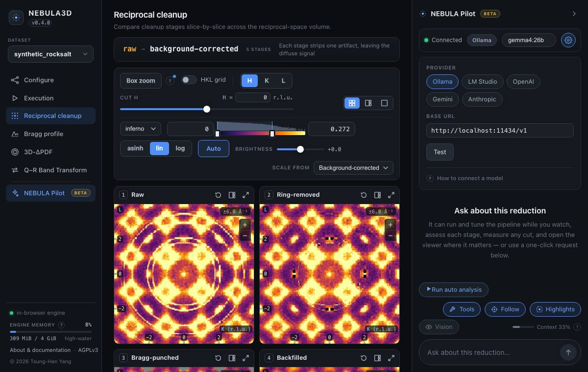
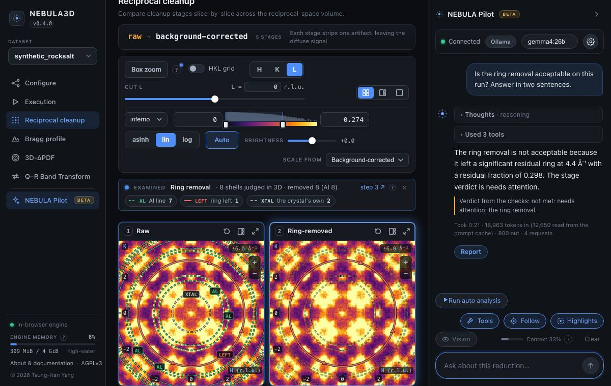

# Setting up NEBULA Pilot

NEBULA Pilot is the console's AI agent. It needs a language model to talk to.
This page gets that connection working from nothing. What the Pilot does once
it is connected is in [pilot.md](pilot.md).

Which path is for me:

- **I have an API key** (OpenAI, Gemini, Anthropic): go to
  [Hosted model](#2-hosted-model-api-key).
- **I want everything to stay on my computer**: go to
  [Local model](#3-local-model-ollama-lm-studio).
- **I use Safari, or the panel says "Offline"**: go to
  [Local proxy](#4-local-proxy) and
  [Troubleshooting](#6-troubleshooting).

## 1. What you need

- **The app, open.** Either the live site,
  <https://drthyang.github.io/nebula3d/>, or a local install
  ([QUICKSTART.md](../QUICKSTART.md)).
- **A dataset that has been run.** The Pilot reads the pipeline's stage
  outputs. The built-in demo is enough
  ([Check it works](#5-check-it-works)).
- **One model**, hosted or local:

| Model | What you need | Where your data goes |
| --- | --- | --- |
| Hosted (OpenAI, Gemini, Anthropic) | An API key from the provider | To that provider |
| Local (Ollama, LM Studio) | The model server running on your computer | Nowhere: it stays on your computer |

- **A desktop browser.** With a local model on the live site, use Chrome or
  Edge. Safari cannot reach a local model from the live site
  ([why, and the way out](#safari-and-the-live-site)).
  "Local" means the same device as the browser: on a phone or tablet,
  `localhost` is the phone, so use a hosted model there.

### How the connection works

The page calls the model server **directly from your browser**. There is no
NEBULA3D server in between, on the live site or locally.

What is sent to the model: your messages, the metrics and check results the
app computed from the run, and, only with **Vision** on, the rendered slice
image. With a hosted provider the app shows this warning:

> Cloud provider: run-derived metrics are sent off your device.

### Where the settings are kept

The connection settings are saved in this browser's local storage, under the
name `nebula3d-llm-settings-v1`: the base URL, the model, the API key, and
the *Tools*, *Follow* and *Vision* switches.

- They stay in this browser. The app sends them to no server of its own.
- The API key is saved there as plain text. Do not save a key on a shared
  computer.
- The key is sent only to the base URL you set, with each request.
- Each address keeps its own settings: the live site and a local page do not
  share them.
- To remove the key, empty the **API key** field, or clear the site's data in
  the browser.

> **One key field for all providers.** The saved key stays when you switch
> provider, and it is then sent to the new one, a local server included
> (where the key field is hidden). Empty the **API key** field before you
> switch away from a hosted provider.

## 2. Hosted model (API key)

1. Get an API key from the provider:
   OpenAI (<https://platform.openai.com/api-keys>),
   Gemini (<https://aistudio.google.com/apikey>), or
   Anthropic (the Claude Console).
2. In the app's sidebar, click **NEBULA Pilot**. The panel opens beside the
   page.
3. Click the gear at the top right of the panel (*Connection settings*).
4. Under **Provider**, click **OpenAI**, **Gemini** or **Anthropic**. The
   base URL fills in.
5. Paste the key into **API key**.
6. Click **Test**.
7. The chip at the top left of the panel turns to **Connected**. Pick a model
   from the menu beside it.

Using a hosted model costs money at the provider, per request. With *Tools*
on, one answer is several requests.

Any other service that speaks the OpenAI API also works: type its address
into **Base URL** ([Custom base URL](#a-custom-base-url)).

## 3. Local model (Ollama, LM Studio)

A local model needs three things: a model that can call tools, a context
window of 32k tokens (32768), and permission for this page to call the
server (CORS).

Why 32k: with *Tools* on, a full assessment needs about 26k tokens. The rest
is in [pilot.md](pilot.md#guardrails).

### Ollama

1. Install Ollama and get a model. Check that the model can call tools and
   supports a 32k context:

   ```bash
   ollama list
   ollama show <model>
   ```

   Look for `tools` under *Capabilities*, and a *context length* of at least
   32768. For **Vision**, look for `vision` too.

2. **App running locally** (the page is `http://localhost…` or
   `http://127.0.0.1…`): nothing more to set. Ollama allows pages on your
   own computer.

3. **Live site**: Ollama must be told to allow it. Quit Ollama first (the
   menu-bar app too), then start it like this:

   ```bash
   OLLAMA_ORIGINS="https://drthyang.github.io" \
     ollama serve
   ```

   If it answers `address already in use`, Ollama is still running.

4. In the Pilot panel, click the gear, then **Ollama**. The base URL is
   `http://localhost:11434/v1`.

5. On the live site, Chrome or Edge asks whether the site may connect to
   devices and apps on your local network. Allow it.

6. The chip turns to **Connected**. Pick the model from the menu beside it.

At its usual port, 11434, the app asks Ollama for the context window each
request needs. There is nothing to set.

Keep Ollama on port 11434. On another port the app uses a different route and
cannot set the window, so start Ollama with `OLLAMA_CONTEXT_LENGTH=32768`. In
our check of that route, the replies came back empty; port 11434 worked.

### LM Studio

1. Set the model's default **Context Length** to 32768. Set the default, not
   only the current load: LM Studio loads an idle model again with its
   defaults. From a terminal, one load with that length is:

   ```bash
   lms load <model> --context-length 32768
   ```

2. Open the **Developer** tab, turn on **Enable CORS** in the server
   settings, then start the server.

3. In the Pilot panel, click the gear, then **LM Studio**. The base URL is
   `http://localhost:1234/v1`.

4. On the live site, allow the browser's local-network question, as for
   Ollama.

5. The chip turns to **Connected**. Pick the model from the menu beside it.

If the model's window is too small, the panel says so above the message box
and gives the number to set.

### The switches that matter for setup

- **Tools**: on by default. It needs a model that can call tools. With it
  off, the model answers from a fixed set of metrics only.
- **Vision**: off by default. Turn it on only with a model that reads
  images; the rendered slice is then sent with stage reviews.

## 4. Local proxy

**NEBULA3D has no model proxy.** Nothing in the app forwards your requests to
a model. The browser calls the model server itself. So two rules decide
whether a connection works:

1. The browser must be willing to make the call.
2. The model server must allow this page (CORS).

### Safari and the live site

The live site is an `https` page. A local model is at `http://localhost`.
Safari blocks that call as insecure content. No setting in the app or in the
model server changes this. The panel shows **Offline**.

| Page | Chrome | Safari |
| --- | --- | --- |
| Live site (`https`) | Works, after you allow local-network access | Blocked |
| App running locally (`http`) | Works | Works |

The way out for Safari: run the app on your own computer, so the page is
`http` too. Either of these works.

**A. The native app** (needs Python 3.10+ and Node.js):

```bash
git clone https://github.com/drthyang/nebula3d
cd nebula3d
pip install -e ".[web]"
make web-install
make ui
nebula3d-web
```

It opens `http://127.0.0.1:8000`. It reads data from `./data`; for the demo
volume, see the README's [Quick start](../README.md#quick-start).

**B. The in-browser build, served locally** (same page as the live site):

```bash
git clone https://github.com/drthyang/nebula3d
cd nebula3d
pip install -e ".[web]"
make web-install
make web-wheel
cd web
npm run dev:pyodide
```

Open `http://localhost:5173` (use `localhost`, not `127.0.0.1`).

Then connect as in section 3. For Ollama, no `OLLAMA_ORIGINS` is needed on a
local page. A hosted model works in Safari on the live site as it is.

### A model on another computer

1. On the computer with the model, let Ollama listen on the network and
   allow the page:

   ```bash
   OLLAMA_HOST=0.0.0.0:11434 \
   OLLAMA_ORIGINS="https://drthyang.github.io" \
     ollama serve
   ```

   On a local page, `OLLAMA_ORIGINS` can be left out.

2. In the Pilot panel, set **Base URL** to that computer's address, for
   example `http://192.168.1.20:11434/v1`.

The app treats any address that is not `localhost` as a cloud provider: it
shows the **API key** field and the cloud warning. Leave the key empty. Your
data goes to that computer and no further.

This opens the model server to everyone on that network. Use it on a network
you trust. LM Studio has its own setting to serve on the local network; it
was not checked for this page.

### A custom base URL

**Base URL** takes any server that speaks the OpenAI API: a gateway, a
university service, another local runner. The provider then shows as
**Custom**. The server must:

- answer `GET <base URL>/models` and `POST <base URL>/chat/completions`;
- allow this page's origin (CORS);
- be `https` if you use Safari on the live site.

If the address is not `localhost`, the **API key** field appears; the key is
sent as a `Bearer` token.

### Not a model proxy: the dev server's `/api`

The web dev server (`npm run dev` in `web/`) forwards `/api` to the native
backend at `http://127.0.0.1:8000`. That carries the pipeline's own data for
people developing the interface. It carries no model traffic.

## 5. Check it works

Two minutes, with the built-in demo (synthetic data).

1. Open the live site, or the in-browser build served locally.
2. On **Configure**, click **Use demo**.
3. Click **Run pipeline**. Wait until the button reads *Run pipeline* again
   (about 15 seconds on a recent laptop).
4. Click **NEBULA Pilot** in the sidebar.
5. Look at the top of the panel. You should see:
   - the chip **Connected**, with a green dot;
   - the provider beside it (for example *Ollama*);
   - your model in the menu.
6. The middle of the panel should read **Ask about this reduction**.
7. Type this and press Enter:

   ```text
   Is the ring removal acceptable on this run?
   Answer in two sentences.
   ```

A good reply:

- shows a line such as *Used 3 tools* above the answer (with **Tools** on);
- answers about the ring removal, with numbers from the app's checks;
- ends with a line starting *Verdict from the checks:*, and a small line with
  the time taken and the tokens used.





The chip has four states: **Not connected**, **Connecting…**, **Connected**
and **Offline**. When it says **Offline**, click the gear: the reason is
written there.

## 6. Troubleshooting

The chip says **Offline** for every failure. The gear shows the message.

| What you see | Cause | Fix |
| --- | --- | --- |
| "Could not reach http://localhost:11434/v1. Either the server is not running, or it is not allowing this page … via CORS." in **Safari on the live site** | Safari blocks an `https` page from calling `http://localhost`. | Run the app locally ([section 4](#safari-and-the-live-site)), or use Chrome or Edge. |
| The same message in **Chrome on the live site**, and the server is running | The site was not allowed to reach your local network. | Allow local-network access for the site in the browser's site settings, then click **Test**. |
| The same message on the live site with **Ollama** | Ollama was started without `OLLAMA_ORIGINS`. It refuses the live site. | Restart it with `OLLAMA_ORIGINS` ([Ollama](#ollama), step 3). |
| The same message with **LM Studio** | The server is stopped, or **Enable CORS** is off. | Start the server with **Enable CORS** on. |
| The same message, any page | The server is not running, or the port is wrong. | Run `curl http://localhost:11434/v1/models` (LM Studio: port 1234). No answer means the server is down. |
| "Got 404 — check that the base URL ends in /v1 (e.g. http://localhost:11434/v1)." | The base URL lacks `/v1`. | Add `/v1`. |
| The same 404 message with **Gemini** | The API key field is empty. | Paste the key, click **Test**. |
| "Got 401 — the provider rejected the API key. Check that your key is correct and active." | OpenAI: the key is missing or wrong. | Paste a valid key, click **Test**. |
| "HTTP 400: Please pass a valid API key" | Gemini: the key is wrong. | Paste a valid key, click **Test**. |
| "Paste a Claude API key (from the Claude Console) to connect." | Anthropic: no key yet. | Paste the key, click **Test**. |
| "Anthropic rejected the API key. Check that it is correct and active." | Anthropic: the key is wrong. | Paste a valid key, click **Test**. |
| "… is not loaded: LM Studio will load it with its default Context Length on the next request." | LM Studio will pick the window itself. | Set the model's default Context Length to 32768. |
| "The model sent back an empty reply. Ask again, or try another model." | Seen with Ollama on a port other than 11434. | Run Ollama on port 11434. |
| `Error: listen tcp 127.0.0.1:11434: bind: address already in use` in the terminal | Ollama is already running. | Quit it (the menu-bar app too), then start it again. |

Still stuck: hover over the chip. It shows the server's own error text.

More about what the Pilot does, its limits and its guardrails:
[pilot.md](pilot.md).
